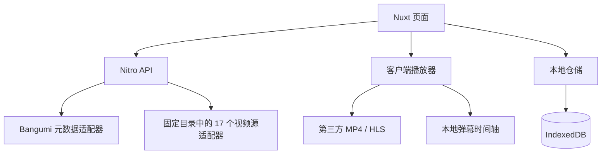

# 架构决策

## 范围

Nuxt 4 + Nuxt UI 4 + Vue + TypeScript 的模块化单体。Nitro 提供资料与视频源接口；播放器、本地记录与弹幕渲染在浏览器中运行。首版以在线 MP4/HLS 为范围，无账户、云同步、用户数据库。

## 模块

| 路径                                          | 职责                                                   |
| --------------------------------------------- | ------------------------------------------------------ |
| `app/pages`                                   | 首页、搜索、时间表、详情、播放、历史、设置和播放器体验 |
| `app/components/player`                       | 视频生命周期、状态、进度事件和弹幕渲染                 |
| `app/repositories`                            | 本地记录、偏好、自定义地址、弹幕持久化                 |
| `app/composables/useLocalLibrary.ts`          | SSR 安全的本地列表状态                                 |
| `server/providers/metadata/bangumi.ts`        | 上游模型转换、分页和缓存                               |
| `app/components/GlassCard.vue`                | 基于 UCard 的玻璃材质容器                              |
| `app/composables/useSourcePreferences.ts`     | 本地源启用偏好与会话检测状态                           |
| `server/providers/video/source-catalog.json`  | 经审查的固定来源、域名及选择器目录                     |
| `server/providers/video/selector-provider.ts` | 上游访问、缓存、匹配与解析编排                         |
| `server/providers/video/parsers.ts`           | HTML / JSON 搜索、章节与静态播放配置解析               |
| `server/utils/resource-token.ts`              | 有时效的服务端资源签名                                 |
| `shared`                                      | 公共模型、身份、校验和格式化                           |

`#shared` 别名用于跨端共享引用，避免构建产物中的相对源文件路径。浏览器 API 仅在客户端生命周期或客户端页面使用。

共享状态由 `app/stores` 下的 Pinia Store 管理；原有 composable 通过 `storeToRefs` 保留调用接口。IndexedDB 仓储继续负责持久化。`AnimeCover` 统一 Nuxt Image 封面，布局与播放器使用 VueUse 管理浏览器监听。分工和测试环境细节见 [库接入说明](library-integration.md)。

## 接口

| 方法 / 路径                                | 职责                                                     |
| ------------------------------------------ | -------------------------------------------------------- |
| `GET /api/calendar`                        | 每周番剧时间表                                           |
| `GET /api/subjects/search?q=…&offset=…`    | 动画搜索，每页 24 项                                     |
| `GET /api/subjects/:id`                    | 番剧详情                                                 |
| `GET /api/subjects/:id/episodes`           | 章节，最多 25 页 × 200 项，超过则明确报错                |
| `GET /api/sources`                         | 已登记来源、默认状态与站点总开关                         |
| `POST /api/sources/:id/check`              | 检测指定源的样例搜索，返回可检索 / 无匹配 / 需验证等状态 |
| `GET /api/episodes/:id/resources?source=…` | 依据章节所属番剧查询一个已登记源，签发短期资源凭证       |
| `POST /api/playback/resolve`               | 校验凭证后即时解析，返回 `no-store`                      |
| `GET /api/health`                          | 进程健康，不代表上游视频源健康                           |

播放凭证绑定来源 ID、番剧、章节、固定源路径和线路，默认有效一小时。客户端不能请求任意服务端 URL。自定义视频地址只交给浏览器，服务端不代取。

## 播放生命周期

1. 读取此章节的本地进度、偏好和地址绑定。
2. 读取已启用源，以 3 路并发分批加载候选项；优先检索并等待上次保存的源，精确匹配可自动选择，相似名称由用户确认。
3. 即时解析临时媒体地址，加载原生 MP4 或 hls.js HLS。
4. 等待可以定位后恢复进度；恢复初始化前禁止写入零秒记录。
5. 播放后每约五秒保存；暂停、页面隐藏、切集、卸载时补写。
6. 换源保存当前时间、销毁旧实例，加载新资源后恢复。
7. 失败时有限地尝试尚未尝试的精确匹配线路，不无限重试。
8. 检索与播放解析分别持有 AbortController 与会话编号，换线不会打断其他源的检索；刷新和卸载会取消旧检索并阻止迟到结果回写。

播放地址不长期持久化；本地手动添加的地址是用户明确绑定的例外。原生播放器可能需要点击播放。不同版本的片头或剪辑可能导致换源后的时间不完全对应。

## 数据与隐私边界

`ani-local-library` v1：

- `progress`：复合字符串键 `subjectId:episodeId`，按更新时间建立索引。
- `settings`：音量、倍速、弹幕开关、透明度、偏移、字号、持续时间、显示区域、类型过滤、防重叠和速度同步。旧记录读取时补齐新增字段，数据库继续使用 v1。
- `bindings`：用户手动绑定的 HTTPS 视频地址。

`ani-local-danmaku` v1：按章节键保存导入弹幕。

localStorage 保存 `ani.source-preferences.v1`（已启用源 ID）、`ani.sidebar-hidden`（桌面侧栏状态）与 Nuxt Color Mode 的外观偏好。源检测结果只留在当前页面会话，刷新可重新检测。

记录导入先校验所有数据，再用单个 IndexedDB 事务合并，保留更新时间较新的记录。倒退观看允许降低当前位置；已看状态保留，用户可以手动取消。迟到的旧快照不覆盖新快照。

观看位置不进入 API 请求、Cookie 或服务器数据库。服务器和第三方仍会接收必要的搜索、资料、视频请求；“本地记录”不代表所有网络访问匿名或不存在访问日志。

## 渲染与部署

首页、时间表、搜索、详情 SSR；本地“继续观看”和已看状态客户端补充。播放、历史、设置、体验页 CSR。

首版单个 Node 服务 + HTTPS 入口。视频流直接来自上游，不由 Nuxt 全量缓存。多实例要配置一致签名密钥，并把限流和公共缓存迁到共享设施。

BT、转码、浏览器不支持的容器/编码和复杂网页解析需要后续独立媒体进程；当前架构不宣称已支持这些能力。

## 来源更新与解析边界

源目录是构建时的受审查快照，不在运行时执行远程订阅代码。选择器只用于静态 HTML / JSON；播放配置只通过 JSON.parse 和 URL 解码读取，不执行源站脚本，不加载源站 iframe。服务端只访问该源登记的 origin，跳转也必须在同一允许列表中，并限制超时与响应体大小。

未知加密、浏览器验证、额外解析器、跨域限制和不可访问媒体会明确失败，随后允许换线。脚本 `scripts/update-source-catalog.mjs` 只生成 `output/source-research/catalog-proposed.json`，保留已审核域名与来源集合；新增来源和域名需修改注册目录并验证。更新运行目录后重新构建，缓存命名空间在解析逻辑变化时更新。

## ArtPlayer 客户端边界

播放器组件在 onMounted 中动态加载 ArtPlayer、官方弹幕插件和按需 HLS 引擎。保持 `flush` / `position` 暴露接口及 progress / fatal / settings 事件，观看页继续控制源检索和失败换线。进度事件携带播放器创建时的来源快照，避免旧实例卸载时写入新线路的来源信息。

ArtPlayer 内置自动续播关闭，进度仍由 IndexedDB 仓储管理；播放器的自动重连关闭，由观看页执行有限换线。卸载时保存有效进度，销毁 HLS、ArtPlayer 与插件 Worker，取消加载超时及页面事件。

弹幕插件仅接收经过校验和复制的数组；本地 XML / JSON 由仓储解析，在线弹幕由 Nitro 请求弹弹play官方接口后归一化。弹幕库初次选择需要确认，确认记录只保存在本地，后续打开该集可恢复缓存或按需读取。时间偏移由播放器适配层转换，不提供弹幕发送入口。插件设置仍同步到原有本地偏好仓储。详见 [ArtPlayer 迁移验证](artplayer-migration.md) 与 [在线弹幕接入](online-danmaku.md)。
